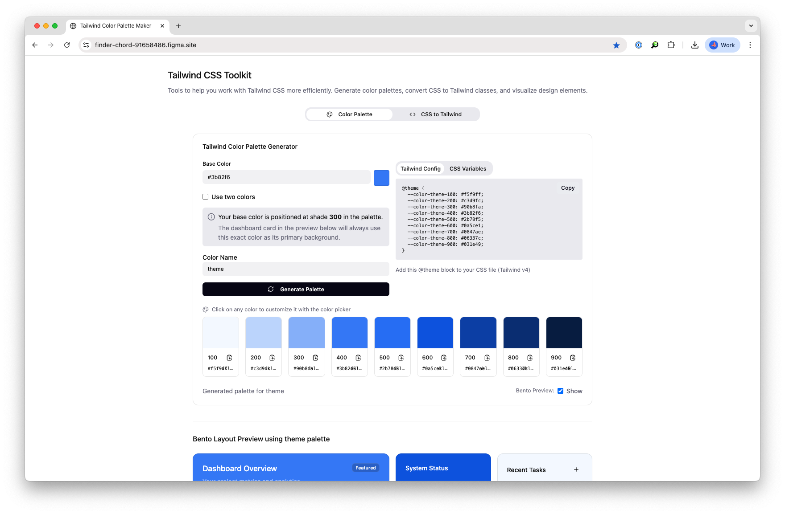

# Tailwind CSS Toolkit

A comprehensive toolkit for working with Tailwind CSS more efficiently. Generate intelligent color palettes, convert CSS to Tailwind classes, and visualize design components in real-time.



## Features

### 🎨 Color Palette Generator
- **Parametric OKLCH Scale**: Lightness, chroma and hue are each driven by a tunable curve across the full 50–950 ramp
- **Pick Your Base Tile**: Pin the input color to any stop and the rest of the ramp bends around it, keeping your color exact
- **Advanced Trajectory Controls**: Ramp endpoints and curve shape, saturation, chroma peak and falloff, plus hue drift at each end
- **Scale Presets**: Tailwind, Soft, Vivid, Neutral and Flat starting points
- **Gamut Mapping**: Chroma is reduced to fit sRGB or Display P3 instead of clipping RGB channels, so hex and OKLCH always agree
- **Dual Color Mode**: Blend a second color as a second anchor while still spanning the whole ramp
- **Native Color Pickers**: Click any color swatch to customize with native browser color picker
- **Multiple Format Support**: View colors in both HEX and OKLCH formats
- **Tailwind v4 Output**: Generate modern `@theme` blocks with CSS custom properties
- **Live Bento Preview**: See your colors applied to real UI components instantly
- **Smart Contrast**: Automatic text color adjustment for optimal readability

### 🔧 CSS to Tailwind Converter
- **Comprehensive Property Support**: Convert a wide range of CSS properties to Tailwind classes
- **Specialized Handlers**: Enhanced conversion for borders, gradients, shadows, and measurements
- **RGBA Color Conversion**: Automatic conversion of RGBA colors to closest Tailwind equivalents
- **Arbitrary Value Fallbacks**: Uses Tailwind's arbitrary value syntax when exact matches aren't available
- **Batch Processing**: Convert multiple CSS declarations at once

### 🎯 Real-time Bento Layout Preview
- **Live Updates**: Automatically updates as you modify colors
- **Comprehensive UI Examples**: Dashboard cards, charts, forms, calendars, and more
- **Contrast Validation**: Ensures proper text readability across all color combinations
- **Responsive Design**: Preview how your colors work across different screen sizes

## Installation

### Prerequisites
- Node.js 18+ 
- npm, yarn, or pnpm

### Setup

1. **Clone the repository**
   ```bash
   git clone <repository-url>
   cd tailwind-css-toolkit
   ```

2. **Install dependencies**
   ```bash
   npm install
   # or
   yarn install
   # or
   pnpm install
   ```

3. **Start the development server**
   ```bash
   npm run dev
   # or
   yarn dev
   # or
   pnpm dev
   ```

4. **Open in browser**
   Navigate to `http://localhost:5173` (or the port shown in your terminal)

## Usage

### Color Palette Generator

1. **Choose your base color** using the color picker or enter a hex/OKLCH value
2. **Pick the base tile** with the pin on any swatch, or leave it on Auto to place the color by lightness
3. **Open Advanced** to reshape the whole scale — lightness curve, saturation and chroma falloff, hue drift, gamut
4. **Optional**: Enable "Blend a second color" to anchor a second color further along the ramp
5. **Name your color scheme** (defaults to "theme")
6. **Lock or customize any stop** by clicking a swatch; locked stops survive regeneration
7. **Copy the output** in either Tailwind v4 @theme format or CSS variables
8. **Preview in context** using the live layout below

#### Example Output (Tailwind v4)
```css
@theme {
  --color-theme-50: #f7faff;
  --color-theme-100: #dae9ff;
  --color-theme-200: #b7d4ff;
  --color-theme-300: #8fbcff;
  --color-theme-400: #63a0ff;
  --color-theme-500: #3b82f6;
  --color-theme-600: #1866ee;
  --color-theme-700: #1150cf;
  --color-theme-800: #123ea9;
  --color-theme-900: #143181;
  --color-theme-950: #152758;
}
```

Shade 500 is the exact base color you put in, because that is where the scale is anchored.

### CSS to Tailwind Converter

1. **Paste your CSS** properties into the input area
2. **Review conversions** - the tool shows both original CSS and Tailwind equivalent
3. **Copy results** to use in your project
4. **Handle edge cases** - properties that don't have direct Tailwind equivalents use arbitrary values

#### Example Conversions
```css
/* Input CSS */
background: linear-gradient(45deg, #ff6b6b, #4ecdc4);
border-radius: 12px;
box-shadow: 0 4px 6px rgba(0, 0, 0, 0.1);

/* Output Tailwind */
bg-gradient-to-br from-red-400 to-teal-400
rounded-xl
shadow-md
```

## Project Structure

```
├── App.tsx                     # Main application component
├── components/
│   ├── PaletteGenerator.tsx    # Color palette generation tool
│   ├── ScaleControls.tsx       # Advanced scale trajectory controls
│   ├── ScaleCurveChart.tsx     # L/C/H curve preview
│   ├── CssToTailwind.tsx      # CSS to Tailwind converter
│   ├── BentoLayout.tsx        # Live preview component
│   ├── ColorPicker.tsx        # Native color picker component
│   ├── ColorSwatch.tsx        # Individual color display
│   ├── figma/
│   │   └── ImageWithFallback.tsx
│   └── ui/                    # shadcn/ui components
├── utils/
│   ├── color-scale.ts         # Parametric OKLCH scale engine
│   ├── color-utils.ts         # Color conversion and contrast helpers
│   ├── oklch-culori.ts        # culori boundary: parsing and gamut mapping
│   └── css-to-tailwind.ts     # CSS conversion logic
└── styles/
    └── globals.css            # Tailwind v4 configuration and base styles
```

## Technology Stack

- **Framework**: React 18 with TypeScript
- **Styling**: Tailwind CSS v4 with custom CSS properties
- **UI Components**: shadcn/ui component library
- **Color Processing**: Custom OKLCH color space utilities
- **Icons**: Lucide React
- **Build Tool**: Vite

## Key Features Explained

### Anchored Scales
Your base color is an anchor, not just one entry in a list. The generator builds lightness, chroma and hue curves across the ramp, then remaps them so the anchored stop reproduces your color exactly while every other stop stays monotone around it. Pin the color to a different tile and the ramp re-fits: pinning a mid-tone to 700 compresses the lights and stretches the darks.

By default the anchor is the stop whose lightness sits closest to your color.

### The Trajectory Controls
- **Lightness** — the endpoints for stops 50 and 950, a curve control that decides how long the scale stays light, and an easing control that compresses both ends
- **Chroma** — an overall saturation multiplier plus the position of the chroma peak and how far chroma falls off toward each end. Falling off into the darks is what keeps them from going muddy
- **Hue** — a drift in degrees applied at each end of the ramp, pinned to zero at the anchor. Shifting the two ends in opposite directions is what gives a scale its warm/cool temperature

Defaults were fitted by least squares against Tailwind v4's own blue, red, emerald and violet ramps.

### OKLCH Color Space
Uses OKLCH (Oklab Lightness Chroma Hue) for perceptually uniform color generation. Out-of-gamut stops have their chroma reduced until they fit the target gamut, which preserves lightness and hue — unlike clipping RGB channels, which shifts the hue and makes a stop's hex and OKLCH forms disagree.

### Tailwind v4 Support
Generates modern Tailwind v4 `@theme` blocks instead of legacy JavaScript configuration, making it easy to integrate with the latest Tailwind CSS.

## Development

### Adding New Features
1. **Scale math**: Extend `utils/color-scale.ts`
2. **Color utilities**: Extend `utils/color-utils.ts`
3. **CSS conversions**: Add handlers in `utils/css-to-tailwind.ts`
4. **UI components**: Follow shadcn/ui patterns in `components/ui/`

### Customizing Styles
The project uses Tailwind v4 with CSS custom properties defined in `styles/globals.css`. Modify the `:root` and `.dark` selectors to customize the design system.

### Contributing
1. Fork the repository
2. Create a feature branch
3. Make your changes
4. Test thoroughly
5. Submit a pull request

## Browser Support

- Modern browsers with CSS custom properties support
- Chrome 49+, Firefox 31+, Safari 9.1+, Edge 16+

## License

MIT License - feel free to use this project for personal or commercial purposes.

---

**Built with ❤️ using React and Tailwind CSS v4**

*Need help or have suggestions? Open an issue or contribute to make this toolkit even better!*
